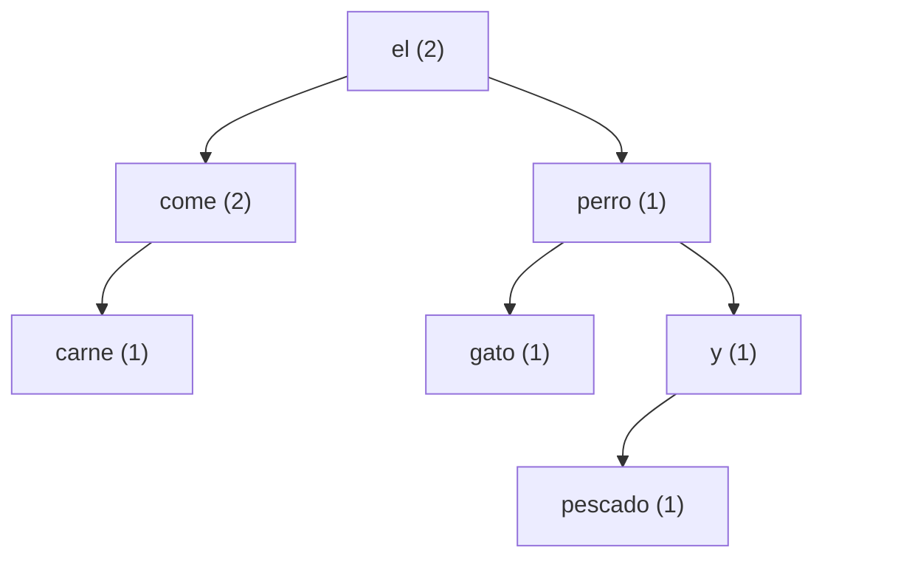

# Árboles Binarios de Búsqueda con apoyo de IA

Programa en **Python 3** que recibe una oración, almacena sus palabras en un
**árbol binario de búsqueda (ABB)** y analiza el árbol generado.

Asistente de IA utilizado durante el desarrollo: **Google AI Studio (Gemini)**.

## Contenido del repositorio

| Archivo | Descripción | Evidencia |
|---|---|---|
| `arbol_bst.py` | Programa funcional | 1 |
| `README.md` (este archivo) | Diagrama del árbol, casos de prueba y resultados | 2, 5 |
| `REGISTRO_IA.md` | Registro de las interacciones con la IA y tabla de verificación | 3, 4 |
| `REFLEXIONES.md` | Reflexión individual de cada integrante | 6 |
| `test_arbol_bst.py` | Pruebas automáticas (`unittest`) | 5 |
| `capturas/` | Capturas de pantalla de Google AI Studio | 3 |

---

## 1. Programa funcional

### Requisitos
- Python 3.8 o superior (no usa bibliotecas externas).

### Ejecución

```bash
python3 arbol_bst.py
# Escribe una oración: el perro come carne y el gato come pescado
```

También se puede pasar la oración como argumento:

```bash
python3 arbol_bst.py "el perro come carne y el gato come pescado"
```

### Pruebas automáticas

```bash
python3 -m unittest -v test_arbol_bst.py
```

### ¿Qué hace el programa?

1. Solicita al usuario una línea de texto (`input`).
2. Divide la oración en palabras (`dividir_en_palabras`).
3. Inserta cada palabra en el ABB (`ArbolBinarioBusqueda.insertar`).
4. Regla de inserción:
   - Palabra **alfabéticamente menor** que la del nodo actual → subárbol **izquierdo**.
   - Palabra **alfabéticamente mayor** → subárbol **derecho**.
   - Palabra **repetida** → ver *Manejo de duplicados*.
5. Muestra los recorridos **inorden**, **preorden** y **postorden**.
6. Calcula el **número total de nodos**, el **número de nodos internos** y la
   **palabra con el máximo valor alfabético**.
7. Muestra la información almacenada en las **hojas** y en los **nodos internos**.

### Decisiones de diseño

**Manejo de duplicados.** Si la palabra ya existe en el árbol **no se crea un
nodo nuevo**: se incrementa el campo `frecuencia` del nodo existente. Así el
árbol conserva la propiedad de ABB (no hay claves repetidas), el número de nodos
equivale al número de palabras distintas y no se pierde la información de
cuántas veces apareció cada palabra.

**Normalización del texto.**
- Todo se convierte a minúsculas: `Hola` y `hola` son la misma palabra.
- Se eliminan los signos de puntuación (`¡ ! ¿ ? , . ; :` etc.).

**Orden alfabético en español.** La comparación directa de cadenas en Python
usa el código Unicode, por lo que `"árbol" > "zorro"` sería `True` (incorrecto).
Por eso se usa la función `clave_alfabetica`, que:
- ignora los acentos para comparar (`á` se compara como `a`);
- coloca la `ñ` después de la `n` y antes de la `o`;
- si dos palabras sólo difieren en el acento (`papa` / `papá`) se consideran
  palabras **distintas** y se desempata por su forma original.

**Nodo interno y hoja.**
- **Hoja**: nodo sin hijos.
- **Nodo interno**: nodo con al menos un hijo. La raíz cuenta como nodo interno
  si tiene hijos; si el árbol tiene una sola palabra, la raíz es hoja.

**Palabra con máximo valor alfabético.** En un ABB es el nodo que se encuentra
más a la derecha, por lo que se obtiene bajando por los hijos derechos
(complejidad O(altura)).

---

## 2. Diagrama del árbol generado con una oración de prueba

**Oración de prueba:** `el perro come carne y el gato come pescado`

Orden de inserción: `el, perro, come, carne, y, el (dup), gato, come (dup), pescado`



Representación equivalente (la muestra el propio programa):

```
el [2]
├── (I) come [2]
│   └── (I) carne [1]
└── (D) perro [1]
    ├── (I) gato [1]
    └── (D) y [1]
        └── (I) pescado [1]
```

Salida completa del programa:

```
Palabras leídas (9): ['el', 'perro', 'come', 'carne', 'y', 'el', 'gato', 'come', 'pescado']

=== Recorridos ===
Inorden   : carne come el gato perro pescado y
Preorden  : el come carne perro gato y pescado
Postorden : carne come gato pescado y perro el

=== Cálculos ===
Número total de nodos       : 7
Número de nodos internos    : 4
Número de hojas             : 3
Altura del árbol            : 4
Palabra con máximo valor alfabético: y

=== Información almacenada ===
Hojas           : carne (frecuencia: 1), gato (frecuencia: 1), pescado (frecuencia: 1)
Nodos internos  : come (frecuencia: 2), el (frecuencia: 2), perro (frecuencia: 1), y (frecuencia: 1)
```

**Verificación manual del árbol:**
- El inorden `carne come el gato perro pescado y` está ordenado alfabéticamente → se cumple la propiedad de ABB.
- 9 palabras leídas, 2 duplicadas (`el`, `come`) → 7 nodos.
- Hojas (3) + nodos internos (4) = 7 nodos totales.
- `y` es el nodo más a la derecha → máximo valor alfabético.

---

## 5. Casos de prueba y resultados

Todos los casos están automatizados en `test_arbol_bst.py`.

| ID | Entrada | Qué se prueba | Resultado esperado | Resultado obtenido |
|---|---|---|---|---|
| CP-01 | `el perro come carne y el gato come pescado` | Recorridos, conteos, hojas e internos | Inorden: `carne come el gato perro pescado y`; Preorden: `el come carne perro gato y pescado`; Postorden: `carne come gato pescado y perro el`; 7 nodos; 4 internos; máx `y` | ✅ Correcto |
| CP-02 | Misma oración | Duplicados | `el` y `come` con frecuencia 2, sin nodos repetidos | ✅ Correcto |
| CP-03 | `¡Hola, Mundo! hola.` | Mayúsculas y puntuación | Palabras `hola, mundo, hola`; 2 nodos; `hola` frecuencia 2 | ✅ Correcto |
| CP-04 | `oso ñandú nube árbol zorro` | Acentos y ñ | Inorden: `árbol nube ñandú oso zorro`; máx `zorro` | ✅ Correcto |
| CP-05 | `papá papa` | Palabras que sólo difieren en acento | 2 nodos distintos; inorden `papa papá` | ✅ Correcto |
| CP-06 | `   ` (vacía) | Entrada sin palabras | 0 nodos, mensaje "árbol vacío", sin errores | ✅ Correcto |
| CP-07 | `hola` | Una sola palabra | 1 nodo, 0 internos, la raíz es hoja | ✅ Correcto |
| CP-08 | `a b c d e` | Palabras ya ordenadas (árbol degenerado) | Altura 5, 4 internos, única hoja `e` | ✅ Correcto |
| CP-09 | `sol sol sol` | Todas iguales | 1 nodo con frecuencia 3 | ✅ Correcto |
| CP-10 | `la inteligencia artificial ayuda pero el programador verifica el código` | Invariante del ABB | Inorden ordenado; hojas + internos = total | ✅ Correcto |

Resultado de la ejecución:

```
$ python3 -m unittest -v test_arbol_bst.py
...
Ran 10 tests in 0.002s

OK
```
